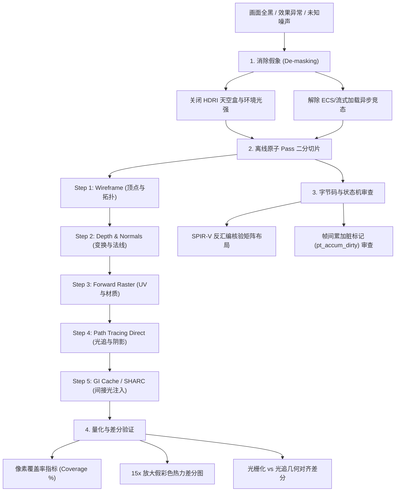

# 渲染管线调查与二分诊断方法论

本文档系统总结在 PrismaRev 图形管线（光栅化、硬件光线追踪/路径追踪、RTXGI/SHARC 辐射度缓存）遇到画面异常、黑屏或未收敛时的标准排查方法与诊断流程。

核心原则：**环境解耦消假象、离线切片二分管线、字节码级审查状态机、量化差分可证伪**。

---

## 一、排查总览与思维模型



---

## 二、四个核心排查维度

### 1. 环境解耦与消除假象（De-masking）

> **“在复杂的渲染管线中，最危险的 bug 往往被绚丽的背景或上层后处理所掩盖。”**

- **关闭全局天光 / HDRI Skybox**：
  - 全景贴图或自发光天空球会把整个视口填满，产生“管线正常运行、有环境反射”的直觉误导，从而掩盖场景几何丢失、相机穿模或裁剪异常。
  - **规则**：在排查几何与基础光照阶段，必须强制将天空盒设为 `enabled: false, intensity: 0.0`，保留纯黑背景，确保视口中出现的每一颗像素都来自于真实的场景网格。
- **解耦流式异步加载与截屏时序**：
  - 复杂 3D 资产（如 103 个子网格的 Crytek Sponza）在启动阶段依赖异步 IO 与反序列化。如果测试截屏仅依帧计数（如第 90 帧）无条件触发，截屏时模型可能尚未挂载至渲染列表。
  - **规则**：截屏守卫必须校验数据就绪状态：
    ```rust
    let frame_plan = screenshot.as_ref().filter(|plan| {
        !screenshot_done
            && plan.fires_on(frame_count + 1)
            && (!packet.draw_items.is_empty() || frame_count >= 300)
    });
    ```
- **编写独立无头离线测试 Harness**：
  - 遇到黑屏疑难杂症时，优先编写 `GraphRenderer::offscreen_new(w, h, None)` 离线测试，直接同步导入 glTF 并注册，消除窗口系统（Winit/X11/Wayland）、UI 悬浮窗和主循环事件泵的干扰。

---

### 2. 管线二分切片定位（Pipeline Binary Slicing）

将渲染管线从输入到输出分解为不可再分的单 Pass，输出单步落盘截图：

| 诊断 Pass | 检查目标 | 异常表象 | 根因范围 |
|---|---|---|---|
| **Step 1: Wireframe** | 顶点与索引缓冲区拓扑 | 画面全黑，或线条错乱炸裂成尖刺 | 子网格未导入、IndexBuffer 越界、顶点步长 (Stride) 错位 |
| **Step 2: Depth Buffer** | 透视投影与 Z 轴连续性 | 全白/全黑，或近处被切断 | 近远裁剪面参数颠倒、Projection 矩阵缺失、Reverse-Z 深度测试函数配错 (`GREATER` vs `LESS`) |
| **Step 3: View Normals** | 顶点法线与面剔除 | 弧形柱面法线缺失平滑、背面穿透 | `cull_mode` 剔除错误、法线未归一化、Slang 矩阵转置导致逆转 |
| **Step 4: Forward Raster** | 材质纹理与直接光照 | 纹理贴图纯黑或全白 | 描述符集绑定漂移、采样器未配置、光照着色器常数越界 |
| **Step 5: Path Tracing Direct** | BVH 与射线击中着色 | 画面纯噪声散粒，无几何阴影 | TLAS/BLAS 加速结构未包含该网格、时间累积缓冲被每帧清零 |
| **Step 6: GI Cache (SHARC)** | 辐射度空间哈希与反弹 | 间接光完全无变化 | 显存初始填充未完成、计算管线同步屏障缺失、哈希键 64 位原子操作未开启 |

---

### 3. 字节码与底层状态机审查

> **“高级 API 与语言绑定层往往隐藏了未收敛的状态陷阱或编译器语义偏差，切勿盲信现有 API。”**

1. **Shader 字节码反汇编（`spirv-dis`）核验**：
   - 现代着色器编译器（如 Slang）在编译为 Vulkan SPIR-V 时，矩阵属性默认为 `RowMajor`，在乘法处生成 `OpVectorTimesMatrix %vec %mat`。
   - 这种排布在底层数学上与 Rust 传入的列主序数组自然等价为列向量乘法。若在 Host 侧盲目添加 `mat_transpose`，反而造成双重转置（Double Transpose），导致几何被拍平或投影翻转。遇到矩阵问题，以反汇编字节码推导为准。
2. **累加缓冲与脏标记（Temporal State）审查**：
   - 路径追踪依赖每帧将新采样加权混合到累加纹理中：
     $$\text{Accum}_{N} = \frac{\text{Accum}_{N-1} \times (N-1) + \text{Color}_{\text{new}}}{N}$$
   - 若 Host 层便利包装函数硬编码 `pt_accum_dirty: true`，每一帧都会强行重置采样计数并清空累加纹理，使画面永远停留在 $N=1$ 的高频散粒状态。

---

### 4. 量化指标与放大差分验证（Quantitative Falsification）

1. **有效像素覆盖率（Pixel Coverage Metric）**：
   - 统计有效像素占全图的百分比：
     $$\text{Coverage} = \frac{\sum_{(x,y)} [\text{Pixel}(x,y) \neq \text{Background}]}{W \times H}$$
   - 示例实测数据：
     - Forward 光栅化：$518,400 / 518,400 = 100.0\%$
     - Wireframe 线框：$449,604 / 518,400 = 86.7\%$
     - Depth 透视深度：$347,159 / 518,400 = 67.0\%$
   - **价值**：瞬间判断是否有子网格漏挂或相机未对准几何体，摆脱肉眼主观臆测。
2. **15x 放大假彩色热力差分图（Amplified False-Color Diff）**：
   - 间接光（GI）的反弹能量通常远低于直接光，人眼极难通过并排对比肉眼辨别其贡献。
   - **算法**：
     $$\text{Diff}(x, y) = \min(255, |\text{Image}_{\text{on}}(x, y) - \text{Image}_{\text{off}}(x, y)| \times 15)$$
   - **判定准则**：
     - 若变动像素为 0，说明 GI 缓存根本未生效（可能为空操作或管线未接通）。
     - 若变动像素集中在走廊背光凹角、拱顶立柱交接处，且呈现连续渐变（如 Sponza 实测 44,159 像素受光，覆盖率 8.52%），则物理证明间接光真实注入。
3. **跨管线几何结构对齐差分（Cross-Pipeline Structural Diff）**：
   - 将光栅化结果与光线追踪结果相减：$|\text{Raster} - \text{PathTrace}|$。
   - 轮廓边缘必须严丝合缝（0 像素边缘位移），差分纯粹来自于直接光模型与全局光照积分的亮度差异。

---

## 三、标准自检清单

在提交任何渲染相关改动前，请依序确认：

- [ ] 已在关闭天空盒的环境下观察几何形态。
- [ ] 离线测试可在无窗口环境下通过 `cargo test --test debug_pipeline_*` 独立稳定复现。
- [ ] Wireframe 拓扑清晰，无退化三角形，无大面积穿透穿模。
- [ ] 深度缓冲与法线缓冲各向渐变平滑，剔除模式符合前后顺逆时针约定。
- [ ] 路径追踪在固定相机下多帧运行，噪点明显随采样累加收敛，无每帧闪烁。
- [ ] 间接光（RTXGI/SHARC）产出 15x 放大差分热力图，受光像素物理分布合理。
- [ ] 运行 `python scripts/pr_ready.py --base origin/dev --quick` 全项呈现绿色 `✅`。
